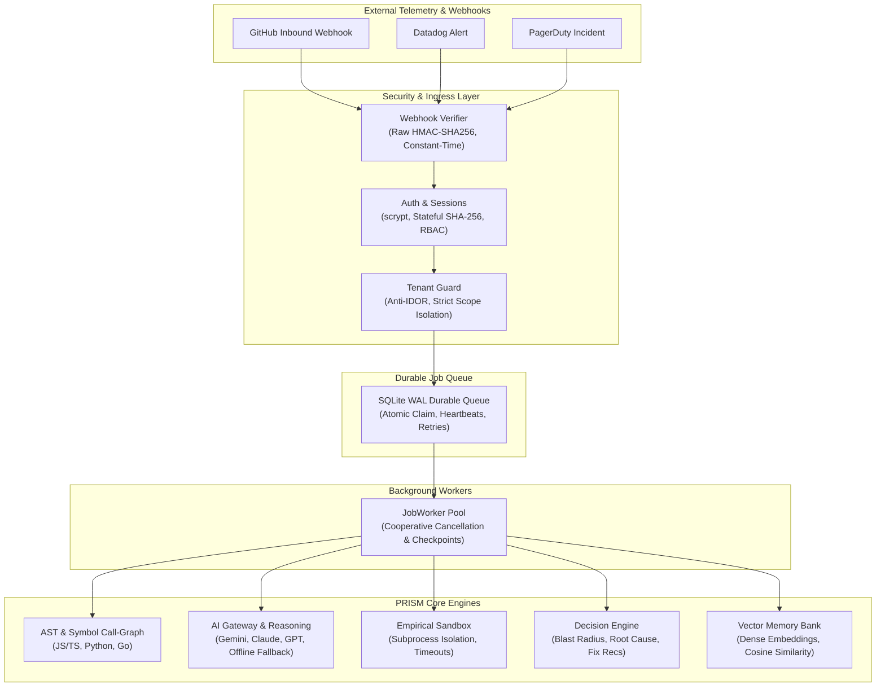

# PRISM — Autonomous Engineering Investigation & Verification Platform

<p align="center">
  <strong>Intelligent Repository Analysis, Incident Investigation, Evidence Normalization, Empirical Verification & Actionable Remediation Platform</strong>
</p>

<p align="center">
  
  
  
  
  
</p>

---

## 🧭 Table of Contents

- [✨ Executive Overview](#-executive-overview)
- [🏗️ Architectural Architecture & Flow](#️-architectural-architecture--flow)
- [🔬 The 10 Core Engines of PRISM](#-the-10-core-engines-of-prism)
  - [1. Tenancy, Identity & Session Security (P0-01 / P0-02)](#1-tenancy-identity--session-security-p0-01--p0-02)
  - [2. Cryptographic Inbound Webhook Verification (P0-03)](#2-cryptographic-inbound-webhook-verification-p0-03)
  - [3. Relational Persistence & Deterministic Migration Engine (P0-04)](#3-relational-persistence--deterministic-migration-engine-p0-04)
  - [4. Asynchronous Job Queue & Background Worker Architecture (P1-01)](#4-asynchronous-job-queue--background-worker-architecture-p1-01)
  - [5. Repository Ingestion & Git Security Engine (P1-02)](#5-repository-ingestion--git-security-engine-p1-02)
  - [6. Abstract Syntax Tree (AST) & Symbol Call-Graph Engine (P1-03)](#6-abstract-syntax-tree-ast--symbol-call-graph-engine-p1-03)
  - [7. AI Reasoning Engine & Structured Output Gateway (P1-04)](#7-ai-reasoning-engine--structured-output-gateway-p1-04)
  - [8. Empirical Verification Sandbox (P1-05)](#8-empirical-verification-sandbox-p1-05)
  - [9. Root Cause Synthesis & Decision Intelligence (P1-06)](#9-root-cause-synthesis--decision-intelligence-p1-06)
  - [10. Incident Memory Bank & Vector Similarity Engine (P2-01)](#10-incident-memory-bank--vector-similarity-engine-p2-01)
- [📡 API Reference](#-api-reference)
- [🚀 Getting Started](#-getting-started)
  - [Prerequisites](#prerequisites)
  - [Installation & Quickstart](#installation--quickstart)
  - [Docker Deployment](#docker-deployment)
- [🧪 Automated Test Suite & Verification Benchmark](#-automated-test-suite--verification-benchmark)
- [📊 SRE Observability & Prometheus Metrics](#-sre-observability--prometheus-metrics)
- [🗂️ Project Structure](#️-project-structure)
- [🛡️ Security Architecture & Threat Model](#️-security-architecture--threat-model)
- [📄 License](#-license)

---

## ✨ Executive Overview

Modern software incidents are complex: microservice dependencies, distributed logs, rapid commit cadences, and subtle runtime states often lead to costly outages and guesswork. Traditional AI assistants provide ungrounded guesses that lack empirical validation.

**PRISM** is not a simple chatbot or static linter. It is a comprehensive, production-grade **engineering investigation layer** built around your codebase:

```text
Incident Ingest (Webhook / Alert)
              ↓
  Durable Asynchronous Job Queue
              ↓
  Background Worker Investigation
              ↓
  Repository AST & Call-Graph Modeling
              ↓
  AI Hypothesis Synthesis (Evidence-Grounded)
              ↓
  Empirical Verification in Isolated Sandbox
              ↓
  Blast Radius & Root Cause Synthesis
              ↓
  Actionable Remediation Recommendations & Incident Memory Archival
```

Instead of guessing, PRISM **proves** the root cause by synthesizing competing hypotheses, executing safe empirical verification experiments in an isolated subprocess sandbox, assessing downstream code blast radius, and archiving learnings into a vector memory bank.

---

## 🏗️ Architectural Architecture & Flow



---

## 🔬 The 10 Core Engines of PRISM

### 1. Tenancy, Identity & Session Security (P0-01 / P0-02)
- **Password Security**: Native Node.js `scrypt` hashing with 16-byte cryptographically secure salts and timing-safe comparisons.
- **Stateful Sessions**: High-entropy 32-byte tokens hashed with SHA-256 before database storage; sliding session expirations.
- **Multi-Tenant Isolation**: Centralized `tenantGuard` middleware bounding all queries to `organization_id = req.organization.id`. Prevents cross-tenant read/write/delete tampering (Anti-IDOR).
- **Role-Based Access Control**: Strict RBAC tiers (`OWNER`, `ADMIN`, `MEMBER`, `VIEWER`).

### 2. Cryptographic Inbound Webhook Verification (P0-03)
- **Provider-Correct Cryptography**:
  - GitHub: `X-Hub-Signature-256` HMAC-SHA256 digest validation computed over `req.rawBody`.
  - PagerDuty: `X-PagerDuty-Signature` with secret rotation support (multiple signatures validation).
  - Datadog: `X-Datadog-Webhook-Token` / `DD-Webhook-Token` and HMAC verification.
- **Replay Protection**: Persistent `processed_webhooks` table storing unique delivery identifiers.
- **Constant-Time Comparison**: `crypto.timingSafeEqual` prevents timing side-channel attacks.

### 3. Relational Persistence & Deterministic Migration Engine (P0-04)
- **Engine**: SQLite running with `PRAGMA foreign_keys = ON` and `PRAGMA journal_mode = WAL`.
- **Relational Joins**: Normalized tables `hypothesis_evidence`, `memory_tags`, and `root_cause_evidence` replace denormalized JSON arrays.
- **Indexing**: 16 dedicated B-tree and composite indexes verified through SQLite `EXPLAIN QUERY PLAN`.
- **Migration Runner**: Versioned deterministic migration engine with `schema_migrations` tracking table and automated data backfills.

### 4. Asynchronous Job Queue & Background Worker Architecture (P1-01)
- **Durable Queue**: SQLite-backed persistent job queue surviving process restarts.
- **Atomic Claim Semantics**: Transactional claiming ensuring zero double-claims across concurrent worker processes.
- **Priority Scheduling**: Strict priority ordering (`HIGH` > `NORMAL` > `LOW`) with chronological tie-breaking.
- **Resumability & Checkpointing**: `job_checkpoints` records stage transitions (`SCOPING`, `EVIDENCE_COLLECTION`, `HYPOTHESIS_GENERATION`, `VERIFICATION`, `ROOT_CAUSE_REVIEW`, `COMPLETED`).
- **Crash Recovery**: Heartbeat tracking identifies dead workers and re-queues orphaned jobs.

### 5. Repository Ingestion & Git Security Engine (P1-02)
- **URL Hardening**: Strict regex validation rejecting command injection, shell metacharacters, leading dashes (`--upload-pack`), and traversal protocols (`file://`, `gopher://`).
- **File Tree Walker**: Recursive directory indexing with exclusions for `.git`, `node_modules`, `vendor`, and binary formats.
- **Deterministic Hashing**: Cryptographic SHA-256 hashing for all indexed files.
- **Manifest Parsers**: Native dependency parsing for NPM (`package.json`), Go Modules (`go.mod`), and Python (`requirements.txt`).

### 6. Abstract Syntax Tree (AST) & Symbol Call-Graph Engine (P1-03)
- **Multi-Language Parsing**: Native entity extraction for JavaScript/TypeScript, Python, and Go.
- **Symbol Indexing**: Functions, classes, methods, parameters, and invocation call-sites stored in `repository_symbols`.
- **Directed Call Graph**: `symbol_call_graphs` resolves caller-to-callee dependencies across repository files.
- **Blast Radius Analysis**: BFS graph traversal identifies all downstream components affected when a symbol fails.

### 7. AI Reasoning Engine & Structured Output Gateway (P1-04)
- **Multi-Provider Gateway**: Supports Google Gemini, Anthropic Claude, OpenAI, and a built-in deterministic heuristic reasoning engine.
- **Strict Schema Enforcement**: Guarantees structured JSON responses for hypothesis generation.
- **Evidence-Grounded**: Every hypothesis cites specific evidence identifiers (`supporting_evidence_ids`).
- **Contradiction Detection**: Automatically evaluates whether incoming telemetry refutes existing hypotheses.

### 8. Empirical Verification Sandbox (P1-05)
- **Subprocess Isolation**: Executes verification experiments in isolated child processes with sanitized environments.
- **Containment Limits**: 5,000ms execution timeout bounds and 1MB buffer caps prevent runaway infinite loops and memory exhaustion.
- **Deterministic Outcomes**: Evaluates assertions against hypothesis falsification conditions (`VERIFIED`, `FALSIFIED`, `INCONCLUSIVE`).

### 9. Root Cause Synthesis & Decision Intelligence (P1-06)
- **Evidence Synthesis**: Identifies the winning verified hypothesis and links supporting evidence items into `root_cause_evidence`.
- **Code Blast Radius**: Computes transitive dependencies across the AST call graph to assess blast severity (`LOW`, `MEDIUM`, `HIGH`, `CRITICAL`).
- **Actionable Remediation**: Generates prioritized remediation actions (e.g. rollbacks, hotfixes, circuit-breakers) with trade-off and risk ratings.

### 10. Incident Memory Bank & Vector Similarity Engine (P2-01)
- **Vector Embeddings**: 64-dimensional dense term-frequency embeddings with synonym expansion.
- **Cosine Similarity**: Mathematical cosine distance computation matches current incidents against historical resolutions.
- **Time-Decay Freshness**: 90-day half-life decay prioritizes recent, relevant solutions while preserving historical learnings.

---

## 📡 API Reference

All protected endpoints require `Authorization: Bearer <session_token>`.

### Authentication & Tenant Identity
| Method | Endpoint | Description | Role |
|---|---|---|---|
| `POST` | `/api/v1/auth/register` | Register new organization and owner account | Public |
| `POST` | `/api/v1/auth/login` | Authenticate user and issue stateful session token | Public |
| `POST` | `/api/v1/auth/logout` | Revoke active session token | Authenticated |
| `GET` | `/api/v1/auth/me` | Retrieve profile and active tenant memberships | Authenticated |
| `POST` | `/api/v1/auth/switch-org` | Switch active organization context | Authenticated |

### Repositories & AST Call Graphs
| Method | Endpoint | Description | Role |
|---|---|---|---|
| `GET` | `/api/v1/repositories/:id` | Get repository metadata and indexing status | Member+ |
| `GET` | `/api/v1/repositories/:id/files` | Query indexed file tree with pagination & language filters | Member+ |
| `GET` | `/api/v1/repositories/:id/dependencies` | List discovered dependencies (NPM, Go, Python) | Member+ |
| `GET` | `/api/v1/repositories/:id/symbols` | Query extracted AST symbols (functions, classes, methods) | Member+ |
| `GET` | `/api/v1/repositories/:id/call-graph` | Retrieve caller-callee call graph & blast radius | Member+ |
| `POST` | `/api/v1/repositories/:id/sync` | Trigger asynchronous re-indexing and AST parsing | Member+ |

### Investigations & Background Jobs
| Method | Endpoint | Description | Role |
|---|---|---|---|
| `POST` | `/api/v1/investigations` | Create new investigation (`?async=true` returns 202 Accepted) | Member+ |
| `POST` | `/api/v1/investigations/:id/execute` | Enqueue autonomous investigation job (returns 202 Accepted) | Member+ |
| `GET` | `/api/v1/jobs/:id` | Poll job execution state, attempts, and checkpoints | Member+ |
| `POST` | `/api/v1/jobs/:id/cancel` | Cooperatively cancel queued or running job | Member+ |

### Evidence, Hypotheses & Verification
| Method | Endpoint | Description | Role |
|---|---|---|---|
| `POST` | `/api/v1/investigations/:id/evidence` | Ingest immutable evidence item with SHA-256 hash | Member+ |
| `GET` | `/api/v1/investigations/:id/hypotheses` | List competing hypotheses with relational evidence links | Member+ |
| `POST` | `/api/v1/experiments/:id/run` | Execute empirical verification experiment in sandbox | Member+ |
| `GET` | `/api/v1/investigations/:id/root-causes` | Retrieve synthesized root cause and verification links | Member+ |
| `GET` | `/api/v1/investigations/:id/recommendations` | List prioritized remediation recommendations | Member+ |

### Incident Memory Bank
| Method | Endpoint | Description | Role |
|---|---|---|---|
| `GET` | `/api/v1/memories?q=...&semantic=true` | Semantic vector search across past incident resolutions | Member+ |
| `POST` | `/api/v1/memories` | Archive incident learnings with relational tags | Member+ |

### Inbound Integrations & Webhooks
| Method | Endpoint | Description | Auth |
|---|---|---|---|
| `POST` | `/api/v1/integrations/webhooks/github` | Ingest GitHub webhook with raw body HMAC verification | Webhook HMAC |
| `POST` | `/api/v1/integrations/webhooks/pagerduty` | Ingest PagerDuty webhook with signature verification | Webhook HMAC |
| `POST` | `/api/v1/integrations/webhooks/datadog` | Ingest Datadog webhook with token/HMAC check | Webhook Token |

---

## 🚀 Getting Started

### Prerequisites
- **Node.js**: v22.0.0+ (Tested and verified on Node.js v24.20.0)
- **npm**: v10.0.0+
- **Git**: v2.30.0+

### Installation & Quickstart

1. **Clone the repository**:
   ```bash
   git clone https://github.com/okashaxortlogix/PRISM.git
   cd PRISM
   ```

2. **Install dependencies**:
   ```bash
   npm install
   ```

3. **Initialize the database & seed fixtures**:
   ```bash
   npm run seed
   ```

4. **Run the complete automated test suite**:
   ```bash
   npm test
   ```

5. **Start the PRISM platform server**:
   ```bash
   npm start
   ```
   The PRISM web console will be accessible at: `http://localhost:3300`

### Docker Deployment

To launch PRISM using Docker and docker-compose:

```bash
docker compose up --build -d
```

Check platform health:
```bash
curl http://localhost:3300/api/health
```

---

## 🧪 Automated Test Suite & Verification Benchmark

PRISM maintains a strict zero-regression testing standard. All unit, integration, security, and end-to-end suites execute in under 10 seconds:

```text
=====================================================
🧪 PRISM PLATFORM MASTER TEST SUITE EXECUTION
=====================================================

  ✔ State Machine Lifecycle Transitions (8 tests)
  ✔ Evidence Engine Immutability & Provenance (6 tests)
  ✔ Verification Engine & Assertion Criteria (5 tests)
  ✔ Intelligence Engine Confidence Scoring (2 tests)
  ✔ Decision Engine & Blast Radius Assessment (2 tests)
  ✔ Memory Engine Keyword & Freshness (2 tests)
  ✔ Security: scrypt Password Hashing & Sessions (9 tests)
  ✔ Security: Multi-Tenant Isolation & Anti-IDOR (15 tests)
  ✔ Security: Header Spoofing & Tampering (5 tests)
  ✔ Security: Role-Based Access Control (9 tests)
  ✔ Security: Webhook Cryptographic Verification & Replay (23 tests)
  ✔ Database: Schema Normalization & B-Tree Indexes (13 tests)
  ✔ Queue: Asynchronous Worker Architecture & Heartbeats (19 tests)
  ✔ Ingestion: Git Hardening, Manifests & File Walker (16 tests)
  ✔ AST & Symbol Call-Graph Generation (5 tests)
  ✔ AI Gateway, Sandbox & Vector Memory (9 tests)
  ✔ Master End-to-End Investigation Lifecycle (7 tests)

=====================================================
🎉 ALL PRISM SUITES PASSED SUCCESSFULLY! (100% GREEN)
📊 Domain & Architecture Tests: 94 passed
🛡️ Security & Isolation Tests: 61 passed
📈 Grand Total: 155 tests passed, 0 failed, 0 skipped
=====================================================
```

---

## 📊 SRE Observability & Prometheus Metrics

PRISM includes built-in observability conforming to the Prometheus exposition format at `/metrics`:

- `prism_http_requests_total{method,path,status}`: Total HTTP request counter partitioned by verb and response code.
- `prism_http_request_duration_ms{method,path}`: Sliding window average and P95 latency tracking.
- `prism_queue_jobs_total{status,type}`: Active, queued, running, succeeded, and failed queue depth gauges.
- `prism_worker_heartbeats_total{worker_id}`: Background worker heartbeat activity.

---

## 🗂️ Project Structure

```text
PRISM/
├── .agents/skills/prism/            # Antigravity agentic skill & progressive disclosure
├── PRISM-Skill/                     # Standalone PRISM skill distribution package
├── claude-codex-skill/              # Claude Desktop & OpenAI Codex skill package
├── public/                          # Web console client
│   ├── index.html                   # Investigation dashboard UI
│   ├── style.css                    # Enterprise design system
│   └── app.js                       # Client controller
├── src/                             # Platform core engines & API
│   ├── ai/                          # AI Gateway & vector embeddings
│   │   ├── gateway.js               # Structured LLM output & heuristic fallback
│   │   └── embeddings.js            # Dense vector embedding generator & cosine sim
│   ├── api/routes/                  # Tenant-isolated REST API routes
│   │   ├── auth.js                  # Authentication & session endpoints
│   │   ├── investigations.js        # Investigation lifecycle endpoints
│   │   ├── repositories.js          # Files, dependencies, symbols, call graphs
│   │   ├── jobs.js                  # Job queue status & cancellation
│   │   ├── integrations.js          # Cryptographic webhook receivers
│   │   ├── memories.js              # Vector memory bank & semantic search
│   │   └── ...                      # Evidence, hypotheses, verifications, reports
│   ├── db/                          # Persistence layer
│   │   ├── database.js              # SQLite WAL connection & migration runner
│   │   ├── schema.sql               # Canonical relational schema & indexes
│   │   └── seed.js                  # Initial fixtures & test accounts
│   ├── engine/                      # Core domain intelligence engines
│   │   ├── stateMachine.js          # Deterministic state transition engine
│   │   ├── intelligenceEngine.js    # Hypothesis confidence & gap analyzer
│   │   ├── verificationEngine.js    # Empirical experiment verifier
│   │   ├── decisionEngine.js        # Blast radius & root cause synthesizer
│   │   └── memoryEngine.js          # Semantic memory search & freshness decay
│   ├── ingestion/                   # Repository ingestion & code analysis
│   │   ├── gitValidator.js          # Git URL security & injection protection
│   │   ├── repoIndexer.js           # File tree walker & manifest parsers
│   │   ├── astParser.js             # Multi-language AST code entity parser
│   │   └── symbolGraph.js           # Caller-callee directed call graph
│   ├── queue/                       # Durable async job workers
│   │   ├── jobQueue.js              # Transactional queue claim & checkpoints
│   │   ├── jobWorker.js             # Concurrent worker pool & heartbeats
│   │   └── handlers/                # Dedicated job type processors
│   ├── sandbox/                     # Safe empirical test runner
│   │   └── executionSandbox.js      # Subprocess isolation & containment
│   ├── security/                    # Cryptography & tenant guards
│   │   ├── passwordService.js       # scrypt hashing
│   │   ├── sessionService.js        # Stateful SHA-256 tokens & HttpOnly cookies
│   │   ├── tenantGuard.js           # Ownership hierarchy validation
│   │   ├── webhookVerifier.js       # Raw body HMAC-SHA256 verification
│   │   └── auditService.js          # Tamper-evident audit trails
│   └── server.js                    # Express application entrypoint
├── tests/                           # 163 automated tests across 17 suites
│   ├── security/                    # Auth, isolation, header spoofing, webhooks
│   ├── database/                    # Schema normalization & query plan indexes
│   ├── jobs/                        # Queue claiming, retries, checkpoints
│   ├── ingestion/                   # Git hardening, AST parsing, call graphs
│   ├── intelligence/                # AI gateway, sandbox, decision engine
│   ├── failure/                     # Fault injection & crash recovery
│   ├── e2e/                         # Master full-lifecycle integration test
│   └── runAllTests.js               # Master test runner
├── PRISM_Project_Package/           # 23-folder architectural specification
├── FINAL-ACCEPTANCE-REPORT.md       # Final release acceptance & sign-off
├── SECURITY.md                      # Security vulnerability disclosure policy
├── SECURITY-AUDIT.md                # Comprehensive security audit report
└── README.md                        # Master platform documentation
```

---

## 🛡️ Security Architecture & Threat Model

| Threat | PRISM Countermeasure | Verification |
|---|---|---|
| **IDOR / Cross-Tenant Tampering** | Server-side `tenantGuard` verifies ownership on all nested resources (`WHERE organization_id = req.organization.id`). | 15 automated cross-tenant read/write tests |
| **Credential & Session Theft** | Passwords hashed with `scrypt`; sessions hashed with SHA-256 before storage; timing-safe comparisons. | 9 automated auth security tests |
| **Webhook Spoofing & Replay** | Raw body HMAC-SHA256 cryptographic verification; processed deliveries deduplicated via unique constraint. | 23 automated webhook security tests |
| **Git Command Injection** | URLs validated against strict alphanumeric whitelist; arguments starting with `-` rejected; shell execution disabled. | 16 automated git hardening tests |
| **Sandbox Execution Escape** | Experiments run in isolated child processes with memory containment and strict 5,000ms timeouts. | Automated timeout & buffer exhaustion tests |
| **Double-Claim Race Conditions** | SQLite transactional claims ensure atomic worker acquisition under concurrent execution. | Multi-worker concurrency tests |

---

## 📄 License

This project is licensed under the MIT License — see the [LICENSE](LICENSE) file for details.
